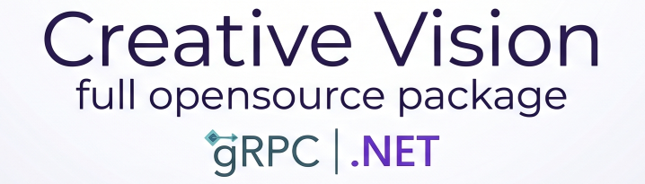

# プロジェクトの目的

このプロジェクト **Creative Vision 10** は、アパレル企業向け販売管理ドメインを対象とした、オープンソースパッケージの開発を目的としています。

アパレル業界では販売管理システムの導入が遅れているケースも多く、特に中小企業ではコスト面や技術面のハードルが高いことが課題です。

**Creative Vision 10** は、そうした企業でも安心して導入できる、本格的な基幹業務ソリューションを目指しています。

アーキテクチャには 3-tier system を採用し、データベース層は SQLite（標準）・PostgreSQL・MariaDB、アプリケーションサーバ層は HTTP/2.0 + gRPC、プレゼンテーション層は WPF + MVVM で構成しています。

2000年代半ば、`CV.net` はクラサバ型の `dbMagic` から `Oracle + .NET 2.0 + Biz/Browser V4` へと開発プラットフォームを移し、3-tier 構成の最初のシステムとなりました。
その後 `CV.net` は、アパレル企業を中心に延べ 200 社へ導入されるまでに成長しました。参考: [3階層基幹業務システム](https://jglobal.jst.go.jp/detail?JGLOBAL_ID=201103030643532794)

2020年代に入ってからは、よりオープンで使いやすいシステムへ生まれ変わるための試行錯誤が続けられました。
**cvnetclient** は、クライアント部分を Biz/Browser から WPF へ置き換えたオープンソースパッケージですが、DB とアプリケーションサーバは従来と同じものを利用していました。

2025年10月に .NET 10 がリリースされ、2026年には AI 開発環境も加速度的に進化し、**Creative Vision 10** の開発も急速に進みました。

2025年11月25日に約 30 ファイルの初期リポジトリを登録して以降、まず既存の `CV.net` 機能の基本部分を完全移行できる状態を目指し、<B>2027年1月のリリース</B>に向けて開発を進めています。

2026年10月に全メニューが完成し、テストフェーズに入りました。2026年11月時点では、POS アプリ（`CvWpfpos`）の統合、PostgreSQL / MariaDB への対応と DB 切替（全データ移行）、原価計算・月次集計の実 DB 検証などを進めています。.NET 11 では async/await の改善などが行われているため、正式リリース後も継続的に機能改善を行う予定です。

**2026/10/08 バージョン 0.9.0 をリリースしました。**

**2026/10/27 バージョン 0.9.1 をリリースしました。**（[リリースノート](Doc/spec/リリースノート_0.9.1.md)）

(リリース予定は随時更新されます)

AI が普及する中、既存の Web システムは OS やミドルウェアの脆弱性により、セキュリティリスクが高まっています。Creative Vision 10 は、オープンソースでありながら HTTP/2、gRPC による高パフォーマンスとセキュリティを重視した設計を行い、将来的な保守性と拡張性を確保しています。この最新の 3-tier アーキテクチャは、今後さらに普及していくでしょう。

**ドキュメント系は [Wiki](https://github.com/sekiya-sato/creativevision10/wiki) へ集約しました。** 開発用の設計・仕様・UAT 資料は `Doc/spec`・`Doc/test` にあります。

[アクティビティ](https://github.com/sekiya-sato/creativevision10/activity?)  [Insights](https://github.com/sekiya-sato/creativevision10/pulse)  [Contributors](https://github.com/sekiya-sato/creativevision10/graphs/contributors?)  [Commits](https://github.com/sekiya-sato/creativevision10/graphs/commit-activity)

---

# 目次

- [プロジェクトの目的](#プロジェクトの目的)
- [目次](#目次)
- [ソリューション概要](#ソリューション概要)
- [特徴・メリット (Creative Vision 10 の十のメリット)](#特徴メリット-creative-vision-10-の十のメリット)
- [プロジェクト別概要](#プロジェクト別概要)
  - [CodeShare (Layer 0)](#codeshare-layer-0)
  - [CvAsset (Layer 0)](#cvasset-layer-0)
  - [CvBase (Layer 1)](#cvbase-layer-1)
  - [CvBase-DB (Layer 1.2)](#cvbase-db-layer-12)
  - [CvPrints (Layer 1.4)](#cvprints-layer-14)
  - [CvDomainLogic (Layer 1.5)](#cvdomainlogic-layer-15)
  - [CvServer (Layer 2)](#cvserver-layer-2)
  - [CvWpfclient (Layer 2)](#cvwpfclient-layer-2)
  - [CvWpfpos (Layer 2)](#cvwpfpos-layer-2)
  - [McpSql / McpOracle (開発支援ツール)](#mcpsql--mcporacle-開発支援ツール)
  - [Tests.\* (Layer 3)](#tests-layer-3)

# ソリューション概要

本ソリューション（`creativevision10.slnx`）は、販売管理ドメインを gRPC ベースで分散実装するための統合環境です。

契約定義（CodeShare）、共通ロジック（CvAsset / CvBase / CvDomainLogic）、DB 別実装（CvBaseSqlite / CvBasePostgre / CvBaseMariadb / CvBaseOracle）、印刷（CvPrints）、gRPC サーバ（CvServer）、WPF クライアント（CvWpfclient）、POS アプリ（CvWpfpos）、開発支援用の MCP サーバ（McpSql / McpOracle）、テスト（Tests.*）で構成されています。

依存方向は `CodeShare` / `CvAsset`（層0）→ `CvBase`（層1）→ `CvDomainLogic`（層1.5）→ `CvServer`（層2）、クライアントは 層0 → 層1 → `CvWpfclient` / `CvWpfpos`（層2）です。

`.NET 10 / C# 14` を前提とし、`protobuf-net.Grpc`、`CommunityToolkit.Mvvm`、`MaterialDesignThemes`、`NPoco`、`Newtonsoft.Json`、`NLog`、`Velopack` などを利用しています。

NuGet パッケージのバージョンは `Directory.Packages.props` で集中管理し、依存関係の整合性を担保しています。

# 特徴・メリット (Creative Vision 10 の十のメリット)

壱. **ライセンスコストの大幅削減**

Oracle、Windows Server、Biz/Browser などの商用基盤への依存を減らし、DB・サーバ OS・業務実行基盤にかかるライセンス費を大きく抑えられます。

弐. **オープンな技術基盤への移行**

従来のクローズドな構成から、.NET 10、SQLite、PostgreSQL、MariaDB、GitHub などを活用したオープンな構成へ移行できます。

参. **将来にわたり保守しやすい**

.NET / C# など利用者の多い標準技術で構成しているため、技術者を確保しやすく、今後の技術更新や保守も続けやすくなります。

肆. **通信性能の向上**

HTTP/2 + gRPC への移行により、従来より高速で効率のよい通信が可能になり、全体の応答性向上が期待できます。

伍. **画面の操作性と表現力の向上**

クライアントを Biz/Browser から WPF に移行することで、画面デザインの自由度が増し、操作性や表示性能の改善が見込めます。

陸. **既存ユーザーが移行しやすい**

これまでの CV 利用実績を踏まえて再設計しているため、既存ユーザーが移行しやすい業務システムになっています。旧 `CV.net`（Oracle）からのデータ変換処理も備えています。

漆. **業務機能の充実**

アパレル販売管理に必要な実務機能が長年蓄積されており、オープンソース化しても業務で使える完成度を維持できます。店舗レジ用の POS アプリも同じサーバに接続して利用できます。

標準機能が充実しているため、個別開発を最小限に抑えて導入できる可能性が高くなります。

捌. **大規模運用の実績がある**

大規模データ、多店舗運用、長年の導入実績があり、基幹業務システムとしての信頼性を備えています。

玖. **長く使える基幹システムを目指せる**

SQLite・PostgreSQL・MariaDB の複数データベースに対応し、DB 間の全データ移行（DB 切替）も可能なため、企業の規模や運用方針に合わせて基盤を選べます。特定製品の提供終了に左右されず、より広く、より長く使える基幹システムとして育てやすくなります。

拾. **AIネイティブな開発およびAI連携の実装**

開発の途中から AI とのバイブコーディングを取り入れています。また、自然言語から SQL を生成して結果を CSV / JSON に保存できる「AI照会」など AI 連携が可能な構成のため、容易にカスタマイズでき、優れた UX を構築できます。

# プロジェクト別概要

## CodeShare (Layer 0)

- gRPC コントラクト（サービス / メッセージ）をコードファーストで定義します。
- サーバ `CvServer` とクライアント `CvWpfclient` / `CvWpfpos` が参照し、型安全な通信を担保します。

## CvAsset (Layer 0)

- 複数プロジェクトで共通利用する軽量ユーティリティ（CSV、旧暦、暗号化など）、定数、補助クラスを集約しています。

## CvBase (Layer 1)

- 共通モデル、NPoco ベースの DB エンティティ、基底インフラを提供します。
- SQL 方言変換（`CvBase/Sql`）を持ちます。SQLite 方言を正典とし、PostgreSQL / MariaDB 向けには実行時に変換します。
- サーバ `CvServer` とクライアント `CvWpfclient` / `CvWpfpos` が参照します。

## CvBase-DB (Layer 1.2)

- データベースを共通的に扱うための汎用 DB I/F（`ExDatabase`）の DB 別実装です。主にインスタンス生成、DDL、列定義などの DB 固有処理を持ちます。
- `CvBaseSqlite`（SQLite 用）、`CvBasePostgre`（PostgreSQL 用）、`CvBaseMariadb`（MariaDB 用）、`CvBaseOracle`（旧 `CV.net` の Oracle DB からの変換用）で構成されています。
- DB 種別によるインスタンス生成の分岐は `CvServer/ExDatabaseFactory.cs` に集約しています。

## CvPrints (Layer 1.4)

- 印刷関連のロジックやテンプレートを提供するプロジェクトです。帳票定義は `printform/*.qfm`（PrintStream 形式、cp932）です。
- プロジェクトファイルの `PrintEnable` が `true` の場合は PrintStream による帳票印刷が有効になります。
- `false` の場合は PrintStream を含めず、印刷データを確認用の一覧 PDF（A4 横）に出力します。

## CvDomainLogic (Layer 1.5)

- 汎用 DB I/F を用いたドメインロジック、集計・原価計算、変換バッチなどを提供します。
- ビジネスロジックの実装をこの層に集約しています。

## CvServer (Layer 2)

- gRPC サーバアプリです。`CoreService` が `ICoreService` を実装し、API を公開します。
- テーブルに対する CRUD 操作、業務処理、自動実行スケジュール（NCrontab）、AI照会、DB 切替などを提供します。
- 使用する DB は `appsettings.json` の `Database:Provider`（`Sqlite`（既定）/ `Postgres` / `MariaDb`）で選択します。
- JSON シリアライズ設定（`JsonSerializerSettings`）を共通化し、`protobuf-net.Grpc` と併用しています。
- `Microsoft.AspNetCore.Authentication.JwtBearer` による認証基盤を利用しています。

## CvWpfclient (Layer 2)

- `CommunityToolkit.Mvvm` と `MaterialDesignThemes` を利用した WPF クライアントです。
- `CvServer` の gRPC API を呼び出し、販売管理のマスタメンテ、受発注、仕入、売上、移動、棚卸、請求・支払、各種帳票などの業務機能を提供します。
- 配布・更新には `Velopack` を利用しています。

## CvWpfpos (Layer 2)

- 店舗レジ用の WPF POS アプリです。`CvServer` の標準 CRUD 経路を利用し、売上入力、保留、商品検索、レシート一覧・再印字、精算（レジ別集計）などを提供します。
- Epson のレシートプリンタ（ESC/POS）と客用表示機に対応しています。

## McpSql / McpOracle (開発支援ツール)

- 開発 DB（SQLite）と旧 `CV.net`（Oracle）を AI エージェントから読み取り専用で参照するための MCP サーバです。
- テーブル一覧・定義・列検索・SELECT 実行などのツールを提供し、更新系 SQL は拒否します。共通部品は `McpCommon` にあります。

## Tests.* (Layer 3)

- テスト用プロジェクトです。
- `TestLogin`（ログイン）、`TestServer`（サーバ・業務ロジック）、`TestSqlDialect`（SQL 方言変換）で構成されています。
- `TestServer` は `OutputType=Exe` のため、`dotnet test --filter` ではなく `TestServer.exe` を直接実行します。
- 実画面を操作する UAT ツールは `Doc/test/UatVm`（POS は `Doc/test/UatPos`）にあります。
